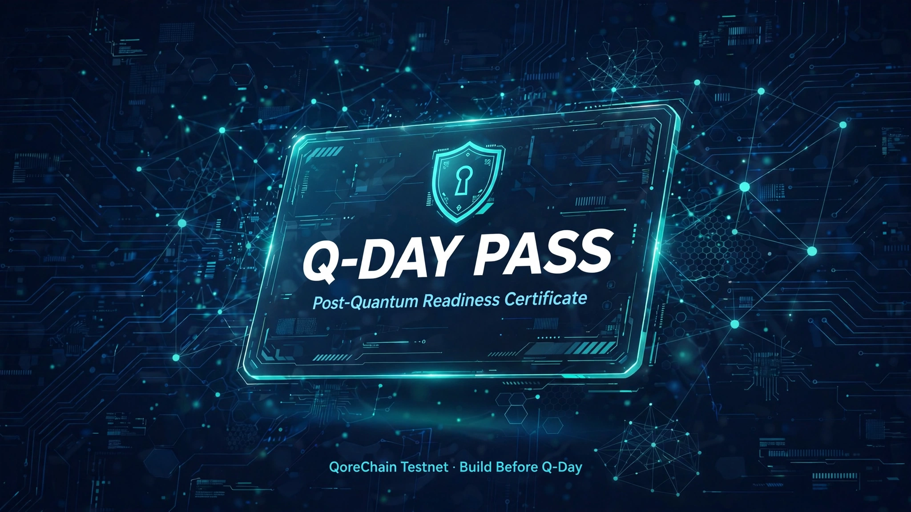

# Q-Day Pass — a post-quantum readiness certificate on QoreChain


**Build Before Q-Day · Quantum Pass track**

Q-Day Pass is a small on-chain certificate: anyone can claim one pass for
their own address, and the pass records their name and the moment they
claimed it. The point of the project is *how* the pass is issued — the
contract is deployed, and the first pass is claimed, inside a QoreChain EVM
authorisation window that was opened with a **hybrid-signed transaction**:
one transaction carrying both a classical secp256k1 signature and a
post-quantum ML-DSA-87 signature (NIST FIPS 204), verified by the chain
itself (`pqc_hybrid_verify` → `verified`).

When quantum computers can break today's signatures ("Q-Day"), systems that
already bind a post-quantum key to every account keep working. This project
is a minimal, complete demonstration of that flow on the QoreChain testnet.

## What is on chain (testnet, `qorechain-diana`, EVM chain id 9800)

| Item | Value |
| --- | --- |
| Project account (native) | `qor1a3lsrek5z9lk4c8990fp0yrkak2hq3ltn02d56` |
| Project account (EVM) | `0xEc7f01E6d4117F6ae0E52bd2179076ED957047Eb` |
| QDayPass contract | `0x50f6D1d359adc7607fF576E3EB123Bfb2d3Ee487` |
| PQC key registration tx | `E7E988EA85D1729786FFB1DC64AAC7F7615D362DAB48F36F1090397AE3CAEE2B` |
| Hybrid-signed window-open tx | `47EC9F3DA0C6335434DC9150A21D59771BC9770385A39EFF0AD6074FE27E143D` |
| First pass claim tx | `0x25a4337ceaf9a981085f9669345379bcef7a7ea0f24aaad457872c59894f306e` |

Verify the hybrid signature of the window-open transaction yourself:

```sh
curl -s https://api-testnet.qore.host/cosmos/tx/v1beta1/txs/47EC9F3DA0C6335434DC9150A21D59771BC9770385A39EFF0AD6074FE27E143D \
  | jq '.tx_response.events[] | select(.type=="pqc_hybrid_verify")'
# → "status": "verified", next to a 4,627-byte ML-DSA-87 signature in the
#   PQCHybridSignature extension and the 64-byte secp256k1 signature.
```

Or paste the hash into the explorer (switch to Testnet):
https://explore.qore.network

## The contract

`contracts/QDayPass.sol` — a pass registry:

- `claimPass(name)` — claim your pass (one per address, name required),
  emits `PassClaimed`.
- `getPass(address)` — read a pass: name, claim time, existence.
- `totalPasses()` / `holderAt(i)` — enumerate passes in claim order.

## Run it yourself

Prerequisites: Node.js 22+, a QoreChain testnet account funded from the
faucet (https://dashboard.qorechain.io/faucet).

```sh
npm install
npm test                 # 6 tests on Hardhat's simulated network
cp .env.example .env     # then put your PRIVATE_KEY + QORE_PQC_RECOVERY_CODE in .env
npm run window -- status     # show account, PQC key, window
npm run window -- register   # one-time: register the ML-DSA-87 key (~0.09 QOR)
npm run window -- open       # hybrid-signed tx: open the EVM authorisation window
npm run build
npm run deploy:testnet       # deploy QDayPass inside the window
PASS_NAME="Your Name" npm run claim:testnet   # claim the first pass, inside the window
```

The throwaway account used for this submission holds testnet funds only.
`.env` is git-ignored and is never committed.

## Kits used

- `create-qorechain-dapp` (Hardhat template) — project scaffold
- `@qorechain/sdk` — unified account, ML-DSA-87 key registration, EVM window
  messages, hybrid signing
- `@qorechain/evm` — EVM window status/cost helpers
- Hardhat 3 + viem — contract build, tests, Ignition deployment

## How it was made

Scaffolded with the official `create-qorechain-dapp` Hardhat template
during the Build Before Q-Day fest, following the fest's Workshop 1 flow
(register key → open window → deploy → verify). The `QDayPass` contract,
its tests, the claim script and this documentation are original to this
project. The work was done with an AI coding assistant; see `AI_USAGE.md`
for the breakdown.

## Licence

MIT — see `LICENSE`. The scaffolded template parts remain under their
original Apache-2.0 licence (see the template's notices in git history).
